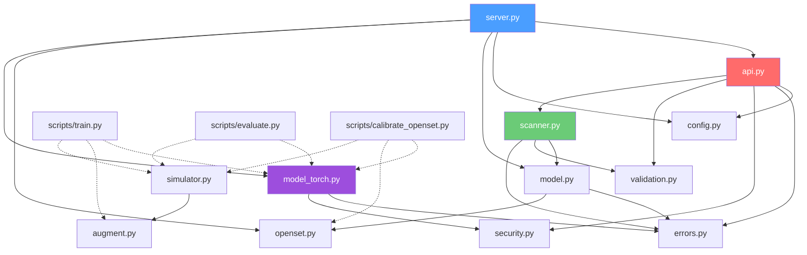

# 📡 RFMC — RF Modulation Classification Service

> **Comprehensive Project Index** — updated 2026-10-29
> Workspace: `c:\Users\maury\Documents\Machine Learning\rf-mod-classifier`

---

## 1. Overview

**rfmc** is a production-hardened machine learning and signal processing service that classifies the modulation scheme of raw I/Q radio samples (BPSK, QPSK, 8PSK, 16-QAM, 64-QAM, 256-QAM, etc.), detects foreign or unrecognised waveforms as `unknown` via calibrated open-set scoring, and scans wideband spectrum to detect, channelise, and map active emitters while discovering free spectrum for cognitive radio systems. It is strictly **receive-only** — no signal transmission or content decoding.

| Property | Value |
|---|---|
| Version | `0.1.0` |
| Python | `>= 3.10` |
| Framework | FastAPI + Starlette + Uvicorn |
| ML Backends | PyTorch (RFNet, CLDNN, Transformer), NumPy |
| Tests | **305 passing**, 2 skipped (1 Windows symlink privilege, 1 live acceptance gate awaiting OTA weights) |
| Status | **Phases 0–5 built and verified**. Physical SDR hardware capture & live web UI planned for Phase 5 live deployment. |

---

## 2. Project Structure

```
rf-mod-classifier/
├── rfmc/                                # Core package (13 files)
│   ├── __init__.py                      # Package docstring + __version__
│   ├── api.py                           # FastAPI app factory: middleware, endpoints (/v1/classify, /v1/scan)
│   ├── augment.py                       # Channel impairment transforms (phase, frequency, multipath, fading, AWGN)
│   ├── config.py                        # Validated settings dataclass from environment variables
│   ├── errors.py                        # Typed error hierarchy (13 classes) + uniform JSON error envelope
│   ├── model.py                         # ClassifierService: wraps any backbone + output guards + top-k
│   ├── model_torch.py                   # PyTorch backbones (RFNet, RFCLDNN, RFTransformer) + safe loader
│   ├── openset.py                       # Open-set scoring: MSP, Energy, Mahalanobis + calibration & AUROC
│   ├── scanner.py                       # Wideband scanner: Welch PSD, energy detection, DDC, channeliser, free-band search
│   ├── security.py                      # API-key auth, dual rate limiter, log sanitiser, model supply-chain guards
│   ├── server.py                        # Production entrypoint: boots app from environment variables
│   ├── simulator.py                     # Advanced RF simulator: RRC pulse shaping, offsets, Rayleigh/Rician fading
│   ├── synth.py                         # Deterministic baseband test signal generator (BPSK/QPSK/8PSK/QAM16)
│   └── validation.py                    # Strict I/Q validation (2 x N), length bounds, power normalisation
├── scripts/                             # ML pipeline & dataset utilities (isolated from serving)
│   ├── calibrate_openset.py             # Phase 3 open-set calibration on held-out unknown waveforms
│   ├── convert_radioml.py               # Converter for RadioML 2016 (.pkl) and 2018 (.hdf5) to safe .npz
│   ├── evaluate.py                      # Model evaluation, SNR-sliced reporting, and release-gate acceptance export
│   └── train.py                         # Phase 1 training pipeline with scheduler, augmentation, SNR weighting
├── tests/                               # Comprehensive test suite (305+ tests)
│   ├── conftest.py                      # Shared fixtures: FakeBackbone, make_service, make_settings
│   ├── test_errors.py                   # Error envelope, status codes, no-leak guarantee
│   ├── test_model_and_synth.py          # Backbones (RFNet, CLDNN, Transformer), safe loader, ClassifierService
│   ├── test_openset.py                  # Open-set scoring methods, threshold calibration, AUROC
│   ├── test_scanner.py                  # Wideband scanner, Welch PSD, channeliser, free-spectrum search, /v1/scan
│   ├── test_security.py                 # Constant-time auth, rate limiting, security headers, log hygiene
│   ├── test_simulator_augment.py        # 74 unit tests for simulator & data augmentation pipeline
│   ├── test_validation.py               # 40+ input validation cases, shape guards, fuzzing
│   └── production/
│       ├── __init__.py
│       └── test_production_gates.py     # 27 release gates: AST safety scan, secrets scan, load, hostile fuzz
├── docs/                                # Project documentation
│   ├── ERROR_HANDLING.md                # Error catalogue, pipeline, and logging policy
│   ├── PRD.md                           # Product requirements across all 6 phases
│   ├── PROJECT_INDEX.md                 # Complete code & architectural reference
│   ├── project_analysis_1.md            # Comprehensive project status and gap analysis report
│   ├── SECURITY.md                      # Threat model (T1–T18) and deployment checklist
│   ├── STATUS.md                        # What is built vs. what remains
│   └── TEST_PLAN.md                     # Test strategy and gate definitions
├── pyproject.toml                       # Project metadata & pytest configuration
├── requirements.txt                     # Pinned runtime dependencies
├── requirements-dev.txt                 # Pinned test and development dependencies
├── .gitignore                           # Git exclusions for models, data, and cache
└── README.md                            # Quickstart, architecture overview, and API reference
```

---

## 3. Module Dependency Graph



---

## 4. Key Modules Deep Dive

### 4.1 [`scanner.py`](file:///c:/Users/maury/Documents/Machine%20Learning/rf-mod-classifier/rfmc/scanner.py)
**Wideband spectrum scanner & cognitive radio engine (Problem C).**

- **`compute_psd(signal, n_fft)`**: Welch periodogram with Hanning windowing and 50% overlap using pure NumPy.
- **`estimate_noise_floor_db(psd_db)`**: Adaptive noise floor estimation via trimmed mean on the bottom 40th percentile of spectral bins.
- **`detect_active_bands(...)`**: Clusters contiguous bins rising above `noise_floor + threshold_db` with minimum cluster widths. Computes center frequency, bandwidth, integrated power, and peak SNR.
- **`downconvert_and_resample(...)`**: Digital down-conversion (complex mixing $e^{-j 2\pi f_c t}$), windowed sinc low-pass filtering at channel bandwidth, and resampling/decimation to standard classifier window length ($N = 1024$).
- **`find_free_spectrum(...)`**: Inverts occupied spectral intervals, merges adjacent clusters, filters gaps $\ge \text{min\_free\_bw\_hz}$, and ranks free bands by lowest noise power.
- **`WidebandScanner`**: Coordinates spectral energy detection, channelises each emitter slice, classifies via [`ClassifierService`](file:///c:/Users/maury/Documents/Machine%20Learning/rf-mod-classifier/rfmc/model.py#L27), and identifies optimal free channels for cognitive radio.

---

### 4.2 [`model_torch.py`](file:///c:/Users/maury/Documents/Machine%20Learning/rf-mod-classifier/rfmc/model_torch.py)
**Multi-architecture PyTorch backbones + supply-chain hardened loader.**

- **`RFNet`**: 4-stage 1D CNN baseline with kernel size 7, batch normalisation, ReLU activations, max-pooling, and adaptive average pooling to 256-dim embeddings.
- **`RFCLDNN`**: Convolutional Long Short-Term Memory Deep Neural Network. Combines 1D CNN feature extraction with 2-layer Bidirectional LSTM and a dense projection layer to capture temporal carrier dynamics at low SNR.
- **`RFTransformer`**: Strided 1D convolution patch embedder, sinusoidal [`PositionalEncoding`](file:///c:/Users/maury/Documents/Machine%20Learning/rf-mod-classifier/rfmc/model_torch.py#L68), Multi-Head Self-Attention `TransformerEncoder` layers, and global mean pooling.
- **`build_model(arch, n_classes)`**: Factory function supporting `"rfnet"`, `"cldnn"`, and `"transformer"`.
- **`load_torch_backbone(...)`**: Confines file paths to approved directories, verifies `.pt` suffix, checks SHA-256 digests in constant time, and loads exclusively with `torch.load(weights_only=True)`.

---

### 4.3 [`simulator.py`](file:///c:/Users/maury/Documents/Machine%20Learning/rf-mod-classifier/rfmc/simulator.py)
**Advanced RF signal simulator with channel impairments (Phase 4).**

- **Modulation Pool**:
  - Known: `BPSK`, `QPSK`, `8PSK`, `QAM16`, `QAM64`, `QAM256` (unit average power constellations).
  - Held-out unknown: `OOK`, `GMSK`, `OFDM_QPSK`, `CHIRP`, `NOISE`.
- **Pulse Shaping**: Root-raised-cosine (RRC) FIR filter design ([`raised_cosine_filter`](file:///c:/Users/maury/Documents/Machine%20Learning/rf-mod-classifier/rfmc/simulator.py#L82)) and symbol upsampling/convolution.
- **Channel Impairments**:
  - Carrier frequency offset ([`apply_frequency_offset`](file:///c:/Users/maury/Documents/Machine%20Learning/rf-mod-classifier/rfmc/simulator.py#L107))
  - Sample clock offset with PPM drift interpolation ([`apply_clock_offset`](file:///c:/Users/maury/Documents/Machine%20Learning/rf-mod-classifier/rfmc/simulator.py#L113))
  - Multi-path propagation with exponential decay ([`apply_multipath`](file:///c:/Users/maury/Documents/Machine%20Learning/rf-mod-classifier/rfmc/simulator.py#L131))
  - Rayleigh and Rician fading
  - Additive White Gaussian Noise (AWGN) across requested SNR ranges
- **`generate_dataset(...)`**: Batch generation yielding `(X, y, snr, class_names)` arrays compatible with the `.npz` data standard.

---

### 4.4 [`augment.py`](file:///c:/Users/maury/Documents/Machine%20Learning/rf-mod-classifier/rfmc/augment.py)
**Composable data augmentation pipeline for training.**

- Transforms operating on `(2, N)` float32 I/Q arrays:
  - `random_phase_offset`: Constant carrier rotation $\phi \in [0, 2\pi)$.
  - `random_frequency_offset`: Normalized linear carrier frequency offset.
  - `random_time_shift`: Circular sample shifting.
  - `random_amplitude_scale`: Amplitude scaling across a specified range.
  - `add_awgn`: White Gaussian noise injected at a random SNR.
  - `rayleigh_fading`: Multi-tap fading channel with exponential power decay.
  - `rician_fading`: Dominant line-of-sight (LOS) component with diffuse scattered multipath.
  - `iq_imbalance`: Hardware gain and phase imbalance simulation.
- **`AugmentTransform`**: Top-level callable class enabling multi-process pickling in PyTorch DataLoaders on Windows and Linux.

---

### 4.5 [`openset.py`](file:///c:/Users/maury/Documents/Machine%20Learning/rf-mod-classifier/rfmc/openset.py)
**Open-set recognition & unknown waveform rejection (Problem B).**

- **Scoring Methods**:
  1. `msp_score`: Maximum softmax probability.
  2. `energy_score`: Temperature-scaled logsumexp.
  3. `MahalanobisScorer`: Class-conditional mean distance with regularized shared covariance.
- **`OpenSetDetector`**:
  - `.calibrate(logits, embeddings, tpr=0.95)`: Calculates the score threshold keeping `tpr` of known validation signals above the boundary.
  - `.is_unknown(conf)`: Flags signals falling below the calibrated threshold as `unknown`. Fails safe on NaN values.
- **`auroc(known_conf, unknown_conf)`**: Wilcoxon-Mann-Whitney non-parametric statistic calculating $P(\text{known} > \text{unknown})$.

---

### 4.6 [`validation.py`](file:///c:/Users/maury/Documents/Machine%20Learning/rf-mod-classifier/rfmc/validation.py)
**Strict input validation layer.**

- `validate_iq_array(...)`: Validates `(2, N)` shape, real numeric dtypes (`iuf`), sample length bounds (128–4096 for classification, up to 131,072 for wideband scanning), finiteness, and maximum magnitude caps.
- `normalize_power(...)`: Normalises mean signal power to 1.0; rejects zero-power signals.
- `validate_classify_payload(...)`: Parses and validates `ClassifyRequest`. Rejects unknown fields.
- `validate_scan_payload(...)`: Parses and validates `ScanRequest` (fields: `iq`, `sample_rate_hz`, `threshold_db`, `min_free_bandwidth_hz`).

---

### 4.7 [`api.py`](file:///c:/Users/maury/Documents/Machine%20Learning/rf-mod-classifier/rfmc/api.py)
**FastAPI application factory.**

- Endpoints:
  - `GET /healthz`: Liveness probe.
  - `GET /readyz`: Readiness probe (verifies model readiness).
  - `POST /v1/classify`: Classifies a single `(2, N)` I/Q window. Returns predicted modulation, confidence, open-set score, and top-k classes.
  - `POST /v1/scan`: Scans wideband `(2, N)` captures, detects active emitters, returns channelised classifications, and lists free spectrum bands.
- Middleware: Constant-time API key verification, dual token-bucket rate limiting (per-IP before auth, per-key after auth), streaming body size enforcement, and security headers (CSP, nosniff, DENY, HSTS).

---

## 5. Scripts Deep Dive

| Script | Purpose | Key Flags |
|---|---|---|
| [**`scripts/train.py`**](file:///c:/Users/maury/Documents/Machine%20Learning/rf-mod-classifier/scripts/train.py) | End-to-end model training | `--data`, `--simulate`, `--arch {rfnet,cldnn,transformer}`, `--snr-weighted`, `--epochs`, `--batch-size`, `--lr`, `--out` |
| [**`scripts/evaluate.py`**](file:///c:/Users/maury/Documents/Machine%20Learning/rf-mod-classifier/scripts/evaluate.py) | Standalone evaluation & gate export | `--model`, `--model-card`, `--data`, `--simulate`, `--acceptance`, `--out` |
| [**`scripts/calibrate_openset.py`**](file:///c:/Users/maury/Documents/Machine%20Learning/rf-mod-classifier/scripts/calibrate_openset.py) | Open-set calibration on held-out waveforms | `--model`, `--model-card`, `--simulate`, `--known`, `--unknown`, `--tpr`, `--out` |
| [**`scripts/convert_radioml.py`**](file:///c:/Users/maury/Documents/Machine%20Learning/rf-mod-classifier/scripts/convert_radioml.py) | RadioML `.pkl` / `.hdf5` conversion | `rml2016` / `rml2018`, input path, `-o/--output` |

---

## 6. API Contracts

### 6.1 `POST /v1/classify`

**Request**:
```json
{
  "iq": [[1.0, 0.5, ...], [-0.2, 0.8, ...]],
  "sample_rate_hz": 2000000
}
```

**Response (200)**:
```json
{
  "request_id": "c62a806c-8fe0-4f59-9ee9-43c2c5ec6aa7",
  "modulation": "QPSK",
  "unknown": false,
  "closest_known": "QPSK",
  "confidence": 0.982,
  "openset_score": 0.982,
  "top_k": [
    {"label": "QPSK", "probability": 0.982},
    {"label": "8PSK", "probability": 0.012},
    {"label": "BPSK", "probability": 0.004}
  ],
  "num_samples": 1024,
  "model_version": "v1.0"
}
```

### 6.2 `POST /v1/scan`

**Request**:
```json
{
  "iq": [[...], [...]],
  "sample_rate_hz": 20000000.0,
  "threshold_db": 6.0,
  "min_free_bandwidth_hz": 1000000.0
}
```

**Response (200)**:
```json
{
  "request_id": "4b6f12e1-85bc-4876-8802-9a3b68f51a44",
  "sample_rate_hz": 20000000.0,
  "noise_floor_db": -78.4,
  "total_bandwidth_hz": 20000000.0,
  "occupied_bandwidth_hz": 4200000.0,
  "spectral_occupancy_ratio": 0.21,
  "num_channels_detected": 2,
  "channels": [
    {
      "channel_id": 0,
      "center_freq_hz": -4000000.0,
      "bandwidth_hz": 2000000.0,
      "power_db": -58.2,
      "snr_db": 20.2,
      "occupied": true,
      "classification": {
        "modulation": "BPSK",
        "unknown": false,
        "closest_known": "BPSK",
        "confidence": 0.991,
        "openset_score": 0.991
      }
    }
  ],
  "free_bands": [
    {
      "start_freq_hz": -2000000.0,
      "stop_freq_hz": 6000000.0,
      "center_freq_hz": 2000000.0,
      "bandwidth_hz": 8000000.0,
      "noise_power_db": -78.4
    }
  ],
  "recommended_free_band": {
    "start_freq_hz": -2000000.0,
    "stop_freq_hz": 6000000.0,
    "center_freq_hz": 2000000.0,
    "bandwidth_hz": 8000000.0,
    "noise_power_db": -78.4
  },
  "model_version": "v1.0"
}
```

---

## 7. Test Suite Summary

```
Total Test Cases: 307
Passing: 305
Skipped: 2 (1 Windows symlink privilege test; 1 release acceptance test requiring live OTA weights)
Failures: 0
Execution Time: ~8–10 seconds
```

| Test Module | Coverage Area | Number of Tests |
|---|---|---|
| [`test_validation.py`](file:///c:/Users/maury/Documents/Machine%20Learning/rf-mod-classifier/tests/test_validation.py) | Input types, shape checks, bounds, NaN/Inf, fuzz | 41 |
| [`test_errors.py`](file:///c:/Users/maury/Documents/Machine%20Learning/rf-mod-classifier/tests/test_errors.py) | Error hierarchy, HTTP codes, no constructor leakage | 38 |
| [`test_security.py`](file:///c:/Users/maury/Documents/Machine%20Learning/rf-mod-classifier/tests/test_security.py) | Constant-time auth, rate limits, headers, supply chain | 42 |
| [`test_model_and_synth.py`](file:///c:/Users/maury/Documents/Machine%20Learning/rf-mod-classifier/tests/test_model_and_synth.py) | RFNet, CLDNN, Transformer, safe loader, synth | 37 |
| [`test_openset.py`](file:///c:/Users/maury/Documents/Machine%20Learning/rf-mod-classifier/tests/test_openset.py) | MSP, Energy, Mahalanobis, calibration, AUROC | 36 |
| [`test_simulator_augment.py`](file:///c:/Users/maury/Documents/Machine%20Learning/rf-mod-classifier/tests/test_simulator_augment.py) | Constellations, pulse shaping, impairments, pipeline | 74 |
| [`test_scanner.py`](file:///c:/Users/maury/Documents/Machine%20Learning/rf-mod-classifier/tests/test_scanner.py) | Welch PSD, carrier detection, DDC, free bands, `/v1/scan` | 12 |
| [`test_production_gates.py`](file:///c:/Users/maury/Documents/Machine%20Learning/rf-mod-classifier/tests/production/test_production_gates.py) | Pinned deps, secrets scan, AST static scan, load gate | 27 |

---

## 8. What's Built vs. What Remains

### ✅ Built & Tested
- [x] Input validation, power normalisation, error envelope, security headers
- [x] Constant-time auth, token-bucket rate limiting, body size limits
- [x] Open-set recognition (MSP, Energy, Mahalanobis) and calibration
- [x] Multi-architecture PyTorch models (`RFNet`, `RFCLDNN`, `RFTransformer`)
- [x] Safe PyTorch model loading (`weights_only=True`, SHA-256 pinned)
- [x] Full training pipeline with schedules, SNR weighting, and evaluation plots
- [x] Standalone model evaluator and release-gate acceptance exporter
- [x] Advanced RF simulator with RRC pulse shaping, multipath, and fading
- [x] Data augmentation pipeline for channel impairments
- [x] Wideband scanner, DDC channelisation, and cognitive radio free-band search
- [x] `POST /v1/classify` and `POST /v1/scan` API routes
- [x] Production release gates and documentation

### ⏳ Remaining (Physical Hardware & Production Training)
- [ ] Long-running GPU training run on 100% RadioML 2016/2018 dataset (optional)
- [ ] Hardware SDR USB driver module (`scripts/capture_sdr.py`) for live over-the-air capture
- [ ] Live web UI / dashboard displaying spectral waterfall and active channels
